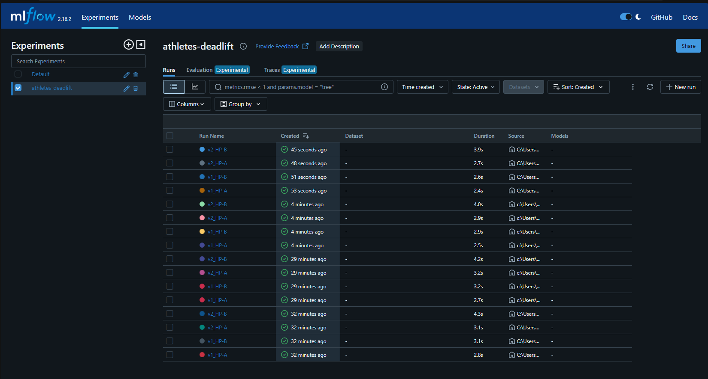

# Feature Store + ML Pipeline (athletes.csv)

Predict an athlete's `deadlift` with a `RandomForestRegressor` (chosen by hand, no AutoML).
4 experiments = 2 feature versions x 2 hyperparameter sets, compared on metrics, plots and carbon.

| | Notebook | Feature store | Tracking | Carbon |
|---|---|---|---|---|
| **Local** | `local_pipeline.ipynb` | Feast | MLflow | CodeCarbon |
| **Databricks** | `databricks_pipeline.ipynb` | Databricks Feature Engineering (Unity Catalog) | Managed MLflow | CodeCarbon |

- **Features v1:** age, height, weight, is_male, bmi
- **Features v2:** v1 + candj, snatch, backsq + each lift divided by bodyweight
- **Hyperparameters:** HP-A = 50 trees, depth 6; HP-B = 100 trees, depth 10
  (HP-B is kept small because Spark on Databricks serverless stops training when a model exceeds ~100 MB,
  so the same values are used in both notebooks)
- Each notebook is self-contained (cleaning, feature store, training, plots and comparison are all in it).
  Both use the same cleaning, split (80/20, seed 42) and plots.

## Run locally
```
conda create -n mlops python=3.11
conda activate mlops
pip install -r requirements.txt
jupyter notebook local_pipeline.ipynb      # run all cells from the repo root
mlflow ui --port 5055                      # optional: browse runs at http://localhost:5055
```
`data/athletes.csv` must be present.
(The notebook creates `feature_repo/`, where Feast keeps its config, parquet files and registry.)

## MLflow reference
Every run is tracked in the `athletes-deadlift` experiment. Each run logs the feature version, the
hyperparameters, the metrics (RMSE, MAE, R²) and the carbon emissions (`emissions_kg`).
The screenshot below is the MLflow UI listing the runs (a run name appears more than once because the
notebook was run several times).



## Run on Databricks
1. Upload `athletes.csv` to `/Volumes/workspace/default/raw/`.
2. Import `databricks_pipeline.ipynb` into your workspace and run all cells.

## Results (local)
| run | RMSE | MAE | R² | emissions (kg CO2) |
|---|---|---|---|---|
| v1_HP-A | 58.32 | 44.88 | 0.632 | 2.0e-06 |
| v1_HP-B | 58.28 | 44.93 | 0.632 | 3.8e-06 |
| v2_HP-A | 36.60 | 27.88 | 0.855 | 3.8e-06 |
| v2_HP-B | 36.04 | 27.47 | 0.859 | 1.0e-05 |

The plots (predicted vs actual, residuals and feature
importance for each run, plus the RMSE and carbon bar charts) are shown in the notebook output.

## Results (Databricks, Spark ML)
| run | RMSE | MAE | R² | emissions (kg CO2) |
|---|---|---|---|---|
| v1_HP-A | 58.96 | 45.48 | 0.622 | 2.3e-05 |
| v1_HP-B | 58.56 | 45.13 | 0.627 | 1.4e-04 |
| v2_HP-A | 37.32 | 28.36 | 0.849 | 2.4e-05 |
| v2_HP-B | 36.75 | 27.96 | 0.853 | 1.8e-04 |

## Analysis
- **Features matter most.** v2 (with the other lifts) cuts the error from about 58 to about 37 in both
  tracks.
- **Hyperparameters matter little.** HP-B (bigger forest) is only slightly better than HP-A.
- **Bigger forest, more carbon.** HP-B emits about 2 to 3 times more than HP-A locally and about 6 to 7
  times more on Databricks, for very little gain. HP-A is the better trade-off.
- **Local vs Databricks.** Results are similar. Databricks errors are slightly higher because Spark ML
  is not identical to scikit-learn, and its emissions are higher because it runs on different hardware.
  CodeCarbon values are estimates, so compare runs within one track.
